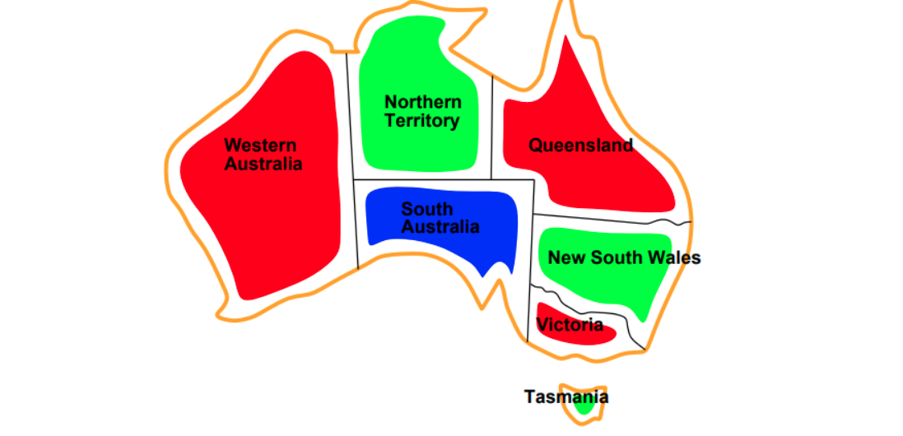

# Семинар №3 - Constraint Satisfaction Problems (CSP)

## Дефиниция на задачата

**Задача за удовлетворяване на ограничения (Constraint Satisfaction Problem, CSP)** е задача, при която трябва да зададем стойности на множество променливи така, че всички ограничения върху тях да са удовлетворени. Интересува ни крайното разпределение на стойностите, а не пътят, по който сме го получили.

Състоянията в CSP се определят чрез следните компоненти:

- **Променливи (Variables):** множество $`X = \{X_1, X_2, \ldots, X_n\}`$. Всяка променлива описва една от величините, чиято стойност търсим.
- **Домейни (Domains):** за всяка променлива $`X_i`$ е зададен домейн $`D_i`$ - множество от допустимите ѝ стойности. Различните променливи могат да имат различни домейни.

Също така имаме:

- **Ограничения (Constraints):** условия, които определят допустимите комбинации от стойности за една или повече променливи. Заедно те формират **goal test**, която показва дали текущата конфигурация от стойности на променливите удоволетворява ограниченията.

**Присвояване (Assignment)** е задаване на стойности на променливи. То е **частично (Partial Assignment)**, ако някои променливи все още нямат стойност, и **пълно (Complete Assignment)**, ако всички имат стойности. Присвояването е **съгласувано (Consistent)**, ако не нарушава ограниченията върху вече зададените променливи.

**Решение (Solution)** е пълно присвояване, което удовлетворява всички ограничения. Съгласувано частично присвояване не означава непременно, че то може да бъде допълнено до решение.

**Пример - оцветяване на карта (Map Coloring):**

- Променливи: областите на Австралия $`WA, NT, Q, NSW, V, SA, T`$.
- Домейни: $`D_i = \{\text{червено}, \text{зелено}, \text{синьо}\}`$.
- Ограничения: съседните области трябва да имат различни цветове, например $`WA \ne NT`$.
- Примерно решение: $`WA = \text{червено}`$, $`NT = \text{зелено}`$, $`Q = \text{червено}`$, $`NSW = \text{зелено}`$, $`V = \text{червено}`$, $`SA = \text{синьо}`$, $`T = \text{зелено}`$.



Други приложения са съставяне на разписания (Timetabling), разпределяне на задачи и ресурси (Assignment Problems) и планиране на транспорт (Transportation Scheduling).

## Видове стойности/домейни

**Дискретни домейни (Discrete Domains):** съдържат отделни, изброими стойности.

- **Крайни домейни (Finite Domains):** например цветове, булеви стойности или редове на шахматна дъска. При $`n`$ променливи с по $`d`$ стойности има $`d^n`$ възможни пълни присвоявания преди прилагане на ограниченията.
- **Безкрайни дискретни домейни (Infinite Discrete Domains):** например целите числа. Ограниченията се описват с формули, вместо чрез изброяване на всички допустими комбинации. Например $`Start_1 + 5 \le Start_2`$ изисква втората задача да започне поне пет дни след началото на първата.

**Непрекъснати домейни (Continuous Domains):** стойностите могат да бъдат реални числа от интервал, например начален момент или продължителност на наблюдение. При линейни ограничения могат да се използват методи на **линейното програмиране (Linear Programming, LP)**.

По-нататък, когато използваме $`n`$ и $`d`$ за оценка на сложност, приемаме крайни домейни с най-много $`d`$ стойности и $`n`$ променливи.

## Видове ограничения

| Вид | Описание | Пример |
| --- | --- | --- |
| **Унарни ограничения (Unary Constraints)** | Засягат една променлива. | $`SA \ne \text{зелено}`$. |
| **Бинарни ограничения (Binary Constraints)** | Засягат две променливи. | $`SA \ne WA`$. |
| **Ограничения от по-висок ред (Higher-order Constraints)** | Засягат три или повече променливи. | $`X_1 + X_2 + X_3 \le 10`$ или ограничение върху общия брой занятия на преподавател за един ден. |

Унарните ограничения могат да се обработят предварително чрез премахване на забранените стойности от съответния домейн.

**Твърди ограничения (Hard Constraints)** трябва да бъдат изпълнени. **Меки ограничения (Soft Constraints / Preferences)** изразяват предпочитания, например даден цвят да е предпочитан пред друг. Ако добавим цени или наказания за предпочитанията, получаваме **задача за оптимизация с ограничения (Constrained Optimization Problem)**.

## Граф на ограниченията

При бинарен CSP **графът на ограниченията (Constraint Graph)** има:

- Връх за всяка променлива.
- Ребро между две променливи, ако между тях има бинарно ограничение.

При оцветяване на карта всяка област е връх, а съседните области са свързани с ребро. Унарните ограничения се отразяват в домейните, а не като ребра между различни върхове.

За ограничения от по-висок ред може да се използва **хиперграф на ограниченията (Constraint Hypergraph)**, в който едно хиперребро свързва всички променливи, участващи в дадено ограничение.

Графовата структура позволява на общи алгоритми за CSP да работят по-бързо: независимите компоненти се решават поотделно, а дървовидните графи позволяват специализиран алгоритъм с полиномиална сложност.

**Пример:** в модела на Австралия Тасмания ($`T`$) няма сухопътна граница с останалите области и е изолиран връх. Цветът ѝ може да се избере независимо.

## Стратегии за решаване на CSP

### Backtracking

**Търсене с връщане назад (Backtracking Search)** е инкрементален подход: изграждаме решението постепенно, като добавяме по едно присвояване. Следва организацията на **търсене в дълбочина (Depth-First Search, DFS)**.

1. **Начално състояние (Initial State):** празно присвояване $`\varnothing`$ - никоя променлива няма стойност.
2. **Стъпка (Successor):** избираме незададена променлива и пробваме стойност от домейна ѝ, която не нарушава ограниченията с вече зададените променливи.
3. **Проверка за цел (Goal Test):** ако всички променливи са зададени и всички ограничения са удовлетворени, имаме решение.
4. **Връщане назад (Backtracking):** ако няма допустима стойност или продължението се провали, отменяме последното присвояване и пробваме следващата възможност.

**Важно:** не отлагаме всички проверки до пълното присвояване. Отхвърляме нарушаващите ограниченията частични присвоявания възможно най-рано.

**Сложност по време:** ако на всяка стъпка разклоняваме и по избор на променлива, и по стойност, броят листа в наивното дърво е:

```math
(nd)((n-1)d)\cdots d = n!\,d^n.
```

Присвояванията обаче са **комутативни (Commutative)**: $`WA = \text{червено}`$, после $`NT = \text{зелено}`$ води до същото състояние като обратния ред. Няма нужда да разглеждаме всичките $`n!`$ подредби.

Ако използваме един фиксиран ред, остават $`d^n`$ възможни пълни присвоявания. Стандартно посочваме **$`O(d^n)`$ експоненциална сложност на търсенето**, без да включваме отделно разходите за проверки на ограничения и евристики. Динамичният избор на една следваща променлива също избягва разклоняването по всички възможни редове.

**Пълнота (Completeness):** да, за крайни домейни, ако се изчерпват всички допустими алтернативи. Алгоритъмът намира решение или установява, че няма такова.

**Сложност по памет:** $`O(n)`$ за текущото присвояване и рекурсивния стек при базов вариант, който генерира алтернативите последователно. Съхраняването и възстановяването на филтрирани домейни изисква допълнителна памет.

#### Подобрения на backtracking

##### 1) Стратегии за избор на следваща променлива

**1.1) Минимум оставащи стойности (Minimum Remaining Values, MRV)**

Избираме незададената променлива с най-малко оставащи допустими стойности. Това е най-ограничената променлива (Most Constrained Variable).

Идеята е да се провалим рано (Fail First): ако някоя променлива е трудна за удовлетворяване, по-добре да открием това, преди да сме направили много други присвоявания. Домейн с нула стойности означава незабавен провал на текущия клон.

**1.2) Евристика по степен (Degree Heuristic)**

При равенство по MRV избираме променливата, която участва в най-много ограничения с други **незададени** променливи. При бинарен CSP това е върхът с най-много все още незададени съседи.

Тя е най-ограничаващата променлива (Most Constraining Variable): нейният избор влияе върху най-много бъдещи решения. Използва се за разрешаване на равенства (Tie-breaking) при MRV.

##### 2) Стратегии за избор на стойност

**2.1) Най-малко ограничаваща стойност (Least Constraining Value, LCV)**

За избраната променлива първо пробваме стойността, която премахва най-малко възможности от домейните на останалите незададени променливи.

Например, ако един цвят оставя на съседните области общо повече допустими цветове от друг, предпочитаме първия. Така запазваме повече свобода за следващите стъпки.

**Разлика:** MRV избира *променлива*, а LCV подрежда *стойностите* на вече избраната променлива. Изчисляването на тези евристики има цена, която може да се компенсира от по-ефикасното търсене.

##### 3) Стратегии за ранно предсказване на провал

**Разпространяване на ограничения (Constraint Propagation)** означава да използваме ограниченията за намаляване на домейните и откриване на противоречия преди пълното присвояване.

**3.1) Проверка напред (Forward Checking)**

След присвояване $`X_i = v`$ премахваме от домейните на незададените съседи стойностите, несъвместими с $`v`$. Ако някой домейн стане празен, веднага се връщаме назад.

Например при $`WA = \text{червено}`$ премахваме червеното от домейните на $`NT`$ и $`SA`$.

Методът проверява последствията от току-що направеното присвояване, но не разпространява автоматично всички последствия между все още незададени променливи. При връщане назад трябва да възстановим премахнатите стойности.

**3.2) Съгласуваност по дъги (Arc Consistency)**

Насочената дъга $`X_i \to X_j`$ е съгласувана, ако за **всяка** стойност $`a \in D_i`$ съществува поне една стойност $`b \in D_j`$, така че двойката $`(a,b)`$ удовлетворява ограничението между променливите. Такава стойност $`b`$ се нарича **поддържаща стойност (Support)**.

```math
\forall a \in D_i\;\exists b \in D_j:\ C_{ij}(a,b).
```

Стойностите без поддръжка се премахват от $`D_i`$. За съгласуваност на целия бинарен CSP се проверяват и двете посоки на всяко ребро.

(**Extra**: Алгоритъмът **AC-3** поддържа опашка от дъги за проверка. Ако обработването на $`X_i \to X_j`$ намали $`D_i`$, отново се проверяват дъгите от останалите съседи към $`X_i`$, защото техни стойности може да са загубили поддръжката си. Процесът завършва при празен домейн или когато повече промени няма.)

За разлика от Forward Checking, така могат да се разпространяват последствия и между незададени променливи. Методът може да се приложи предварително (preprocessing) или след всяко присвояване - **поддържане на съгласуваност по дъги (Maintaining Arc Consistency, MAC)**.

**Важно:** съгласуваността по дъги не гарантира решение в общия случай. Например три взаимно съседни области с по два възможни цвята са съгласувани по дъги, но не могат да бъдат оцветени без конфликт.

##### 4) Възползване от структурата на задачата (графа на ограниченията)

**4.1) Компоненти на свързаност (Connected Components)**

Ако графът се разделя на компоненти без ограничения между тях, всяка компонента е независим CSP. Решаваме ги поотделно и обединяваме намерените присвоявания.

При компоненти с размери $`n_1, \ldots, n_k`$, където $`\sum_i n_i = n`$, експоненциалният разход за намиране на едно решение се намалява от $`O(d^n)`$ до:

```math
O\left(\sum_{i=1}^{k} d^{n_i}\right).
```

Ако всички компоненти са с размер $`c`$, получаваме $`O((n/c)d^c)`$. Ако една компонента няма решение, целият CSP няма решение. Сумата се отнася до намиране на едно решение, а не до изброяване на всички комбинации от решения.

**4.2) Граф на ограниченията, който е дърво (Tree-structured CSP)**

За бинарен CSP с дървовиден граф и крайни домейни можем да намерим решение без обичайното експоненциално търсене:

1. Избираме корен и ориентираме ребрата от родител към дете. Правим **топологично подреждане (Topological Ordering)**, така че всеки родител да е преди децата си.
2. Правим **обратен обход (Backward Pass)** от последния връх към корена. За всяко дете премахваме от домейна на родителя стойностите без поддръжка в домейна на детето. Обработваме дъгата **родител → дете**, като поддървото на детето вече е обработено.
3. Ако някой домейн се изпразни, решение няма. Иначе правим **прав обход (Forward Pass)**: избираме стойност за корена и за всяко следващо дете избираме стойност, съвместима с вече зададения му родител.

Обратният обход гарантира, че допустимата стойност на родителя има подходящо продължение във всяко поддърво. Между различните поддървета няма ребра, които да породят допълнителен конфликт.

**Сложност по време:** $`O(nd^2)`$ при проверка на една двойка стойности за $`O(1)`$. Има $`n-1`$ ребра, всяко изисква до $`d^2`$ проверки при обратния обход, а правият обход е $`O(nd)`$. Същата идея се прилага поотделно върху дърветата в гора.

**4.3) Фиксиране на избрани променливи (Conditioning)**

Избираме малък набор променливи, пробваме стойности за тях и опростяваме останалата задача. Ограниченията към фиксираните променливи филтрират домейните на останалите.

При **фиксиране на разрязващо множество за циклите (Cycle-cutset Conditioning)** избираме множество от $`c`$ променливи, чието премахване превръща графа в дърво или гора:

1. Разглеждаме до $`d^c`$ присвоявания за избраните променливи.
2. Отхвърляме присвояванията, които нарушават ограничения помежду им.
3. Филтрираме останалите домейни спрямо фиксираните стойности.
4. Решаваме остатъчната гора с алгоритъма за дървета. Ако успеем, обединяваме двете присвоявания.

Стандартната оценка за решаването на остатъчните дървета през всички опити е:

```math
O\left(d^c (n-c)d^2\right),
```

към която се добавят проверките и филтрирането за избраното множество. Предимството е, че експоненциалната зависимост е по малкото $`c`$, вместо по цялото $`n`$.

Conditioning може и само да раздели графа на по-малки независими компоненти. Тогава за всяко фиксирано присвояване разходът за останалата задача е сума от разходите за компонентите.

### Min Conflicts

**Итеративното подобрение (Iterative Improvement)** използва **локално търсене (Local Search)**: започваме с пълно присвояване, което може да нарушава ограничения, и променяме отделни стойности, за да намаляваме конфликтите.

**Минимум конфликти (Min Conflicts)** е вариант на **изкачване по хълм (Hill Climbing)** с евристика, измерваща броя нарушени ограничения:

```math
h(s) = \text{брой нарушени ограничения в състоянието } s.
```

Търсим състояние с $`h(s)=0`$. **Конфликтна променлива (Conflicted Variable)** е променлива, участваща в поне едно нарушено ограничение.

**Стандартен алгоритъм:**

1. Създаваме случайно пълно присвояване (Random Initialization).
2. Определяме конфликтните променливи. Ако няма такива, връщаме текущото присвояване като решение.
3. Избираме една конфликтна променлива на случаен принцип.
4. При фиксирани останали променливи избираме стойност от домейна ѝ, която води до най-малко нарушени ограничения.
5. Ако няколко стойности са еднакво добри, избираме случайно между тях.
6. Правим присвояването и повтаряме от стъпка 2 до намиране на решение или достигане на лимит от итерации.

Броят конфликтни променливи и броят нарушени ограничения са различни величини. Първият помага да изберем какво да променим, а вторият оценява качеството на присвояването.

**Пълнота (Completeness):** не при ограничен брой стъпки. Алгоритъмът може да попадне в **локален минимум (Local Minimum)**, **плато (Plateau)** или цикъл. Допускат се и ходове с еднаква оценка; няма гаранция за строго подобрение на всяка стъпка.

**Случайно рестартиране (Random Restart):** след лимит от стъпки започваме от ново начално присвояване. Това намалява риска от продължително засядане, но не гарантира успех за фиксиран брой опити. Неуспехът на Min Conflicts не доказва, че CSP няма решение.

### N-Queens

**Задачата за N царици (N-Queens Problem)** изисква да поставим $`N`$ царици върху дъска $`N \times N`$ така, че никои две да не са на един ред, в една колона или на един диагонал. За положителни $`N`$ решение съществува при $`N=1`$ и при всяко $`N \ge 4`$; за $`N=2`$ и $`N=3`$ няма решение.

В презентацията задачата е поставена за решаване с Min Conflicts, включително за $`N=10\,000`$.

#### 1) Представяне (Representation)

По условие във всяка колона трябва да има точно една царица. Затова вместо матрица използваме вектор `queenPosition` с $`N`$ елемента:

- Индексът $`i`$ е колоната на царицата.
- Стойността `queenPosition[i]` е редът ѝ.
- Индексите на редовете и колоните са от $`0`$ до $`N-1`$.

Така ограничението за колоните се изпълнява автоматично. За всяка двойка колони $`i \ne j`$ остават:

```math
queenPosition[i] \ne queenPosition[j],
```

```math
|queenPosition[i]-queenPosition[j]| \ne |i-j|.
```

Първото условие забранява общ ред, а второто - общ диагонал. Домейнът на всяка променлива е $`\{0,1,\ldots,N-1\}`$.

**Пример:** `queenPosition = [1, 3, 0, 2]` е решение за $`N=4`$, когато редовете се броят отгоре надолу.

**Сложност по памет:** $`O(N)`$ за вектора вместо $`O(N^2)`$ за матрица. При нужда дъската се отпечатва ред по ред, без да се съхранява цялата матрица. Самото отпечатване на всички $`N^2`$ клетки остава $`O(N^2)`$.

#### 2) Инициализация (Initialization)

**Стратегия 1 - случайна инициализация (Random Initialization):** за всяка колона избираме случаен ред. Възможни са конфликти по редове и диагонали. Началното присвояване и броячите могат да се построят за $`O(N)`$.

Вариант е случайна пермутация на редовете: първоначално няма конфликти по редове, но може да има по диагонали. Обичайното преместване на една царица впоследствие не запазва непременно свойството „пермутация“.

**Стратегия 2 - инициализация с минимални конфликти (Min-conflicts Initialization):** поставяме цариците последователно, като за всяка нова колона избираме ред с минимални конфликти спрямо вече поставените царици. При равенство избираме случайно. Това може да даде по-добро начално състояние; директното обхождане на всички редове във всяка колона струва $`O(N^2)`$ дори с бързи броячи.

**Стратегия 3 - инициализация по движение на кон (Knight-move Initialization):** в някои решения се наблюдава повтаряне на стъпка „една колона и два реда“, подобна на ход на кон. Можем да използваме този мотив за начално разполагане.

Това е идея за евристична инициализация, а не универсална гаранция за решение. При достигане на края на дъската и пренареждане на редовете могат да възникнат конфликти, които трябва да бъдат проверени и поправени.

#### 3) Избор на царица за преместване (Queen Selection)

В стандартния Min Conflicts избираме **случайна конфликтна царица**, след което я поставяме на ред с минимални конфликти.

При варианта **Max-Min Conflicts** от презентацията:

1. Избираме царица с **максимален** брой конфликти.
2. Преместваме я на ред с **минимален** брой конфликти.
3. И при двата избора разрешаваме равенствата случайно.

Идеята е първо да поправяме най-проблемната царица. Избирането винаги на първия или последния равностоен кандидат обаче може да доведе до повтарящ се цикъл.

Използваме **рандомизация (Randomization)** и **случайно рестартиране (Random Restart)** след определен брой стъпки, например $`kN`$, където $`k`$ е избран параметър. Проверяваме за решение след преместванията и прекратяваме веднага при нула конфликти. Рестартиранията могат да се организират с външен цикъл, без натрупване на рекурсивни извиквания.

#### 4) Оптимизация на паметта и проверката за конфликти

За да не сравняваме всяка кандидат-позиция с всички останали царици, поддържаме броячи (Counters):

| Масив | Размер | Съдържание / индекс |
| --- | --- | --- |
| `queenPosition` | $`N`$ | Редът на царицата в дадена колона. |
| `conflictRows` | $`N`$ | Брой царици на ред `row`. |
| `conflictNegativeDiagonals` | $`2N-1`$ | Брой царици по диагонали, успоредни на главния: `N - 1 - row + col`. |
| `conflictPositiveDiagonals` | $`2N-1`$ | Брой царици по диагонали, успоредни на второстепенния: `row + col`. |

Имената и индексите следват тетрадката. И в двете диагонални посоки има $`2N-1`$ диагонала; индексите им са от $`0`$ до $`2N-2`$.

**Проверка на кандидат-позиция:** първо временно премахваме избраната царица от трите брояча за текущата ѝ позиция. След това за кандидат-ред `row` в нейната колона `col` пресмятаме:

```python
conflicts = (
    conflictRows[row]
    + conflictPositiveDiagonals[row + col]
    + conflictNegativeDiagonals[N - 1 - row + col]
)
```

Това е **проверка за константно време (Constant-time Conflict Check)** - $`O(1)`$ за една кандидат-позиция. След избора на нов ред актуализираме `queenPosition` и увеличаваме съответните три брояча.

Ако оценяваме царица **на текущото ѝ място, без да я премахваме**, изваждаме 3 от сумата: тя се брои веднъж в своя ред и веднъж във всеки от двата си диагонала. Това правило не бива да се използва механично за други кандидат-редове; временното премахване избягва объркването.

**Сложности:**

- Памет за позициите и броячите: $`O(N)`$.
- Проверка на една кандидат-позиция: $`O(1)`$.
- Обновяване на броячите при едно преместване: $`O(1)`$.
- Избор на най-добър ред чрез обхождане на всички редове: $`O(N)`$.
- Избор на царица с максимални конфликти чрез обхождане на всички царици: $`O(N)`$.
- Една итерация с тези директни обхождания: $`O(N)`$; $`T`$ итерации струват $`O(TN)`$ без инициализацията и отпечатването.

**Важно:** броячите правят бърза оценката на една позиция, но не правят автоматично целия алгоритъм линеен. Общото време зависи и от броя итерации и рестартирания.
