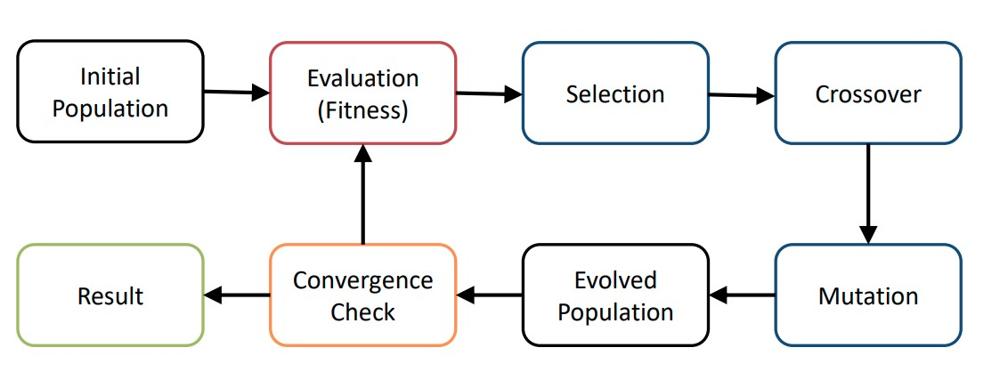
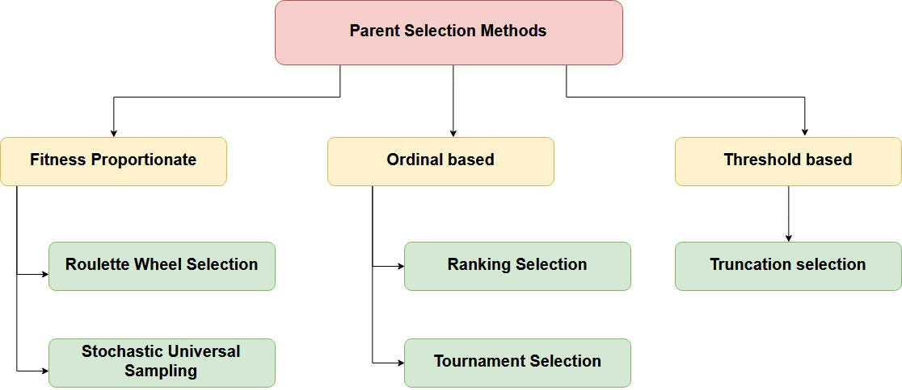
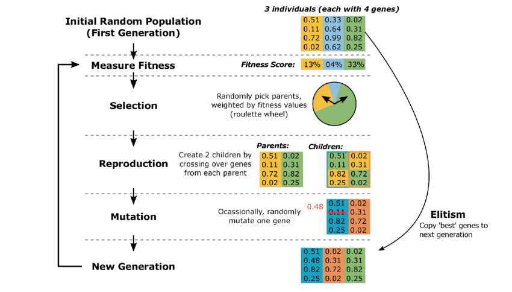

# Семинар №4 - Genetic Algorithms

Досега в курса постепенно надграждахме методите ни за търсене на решение в пространство от състояния. Започнахме от простите **неинформирани стратегии**, след това надградихме с добавянето на *евристика* (**информирани стратегии**), а предния път се запознахме и с **локално търсещи методи**, които опитват да **оптимизиарт** дадено състояние спрямо достижимите в локална негова област други такива (като за целта преформулирахме задачата от просто търсене на валидна конфигурация до оптимизационна задача относно евристика за това колко близо сме до валидна конфигурация - number of conflicts).

Днес ще разгледаме следващата стъпка в процеса на надграждане, който правим, за да получим алгоритъм, който е много близък до концепциите за еволюция и генетика.

## Генетичен алгоритъм - произход

Идеята зад генетичния алгоритъм се базира на две сфери от интерес за науката биология, а именно: **генетика** и **еволюционна теория**. Нека да разгледаме как живите организми се **"оптимизират"**.

Имаме дадена околна среда, в която има група живи организми от един и същ биологичен вид (наричаме ги **популация**). Целта на популацията е да максимизира шансовете си за оцеляване в средата. Нека с **X** бележим произволен индивид от популацията, а с **F(X)** бележим шансовете му за оцеляване. Целта на популацията е да се съставлява от индивиди, чиято оценка F(X) е възможно най-голяма. Съответно, индивиди с малка оценка F(X) пък лесно ще "изчезват" от популацията в следствие на ниската им приспособеност (не могат да се бият, не могат да се размножават, не могат да си набавят лесно храна, не могат да се конкурират, склонни са към заболявания или каквато и да е друга причина). Индивидите с голяма оценка F(X) пък ще имат по-голям шанс да оцелеят по-дълго време и да достигнат етапа на размножаване и създаване на наследници.

Преди да продължим, важно е да отбележим, че слабите индивиди също имат шанс да направят наследници. Оценката F(X) ни казва (грубо) какви са шансовете им да доживеят достатъчно дълго, че да успеят да се размножат. (**Това за нас е вид евристика**)

Всичко казано до момента включва концепциите за еволюция (правило, познато като "силните оцеляват"). Възниква обаче един въпрос - какво става, ако популацията се съставлява от приблизително еднакви и оптимални индивиди (със сходна оценка F(X)), но пък се появи рязка промяна в средата? Ако не са приспособени, в сегашната постановка няма как те да гарантират оцеляването си (все още не сме въвели способ, по който те да могат да се приспособяват) и следователно в даден момент популацията ще изчезне.

Тук идва частта от генетиката - популацията може да се приспособява с течение на времето. Това става чрез два основни момента - **кръстосване** и **мутация**. Кръстосването е процес, при който два оцелели индивида могат да създадат наследници, които да придобият част от характеристиките на единия родител и останалата част - на другия родител. Идеята тук е, че може два индивида с по-ниска средна оценка F(X) да имат такива характеристики, че комбинацията от тях да дава голяма преднина на наследниците им (и те да имат по-голям F(X)). Примерно - ако единият родител е слаб ловец, но резистентен към заболявания, а другият е силен ловец, но податлив на заболявания, то дете, което наследи и двете положителни характеристики, ще е с много по-висок F(X) от родителите си. Това решава част от проблемите - вече има начин популацията да става по-добра от предходните си състояния (**тук виждаме момента на оптимизация на популацията относно евристиката F(X)**).

Какво става обаче в гореспоменатият случай, ако освен сходна оценка F(X) индивидите имат и сходни характеристики (тоест - кръстосването дава сходни резултати)? Природата е открила решение и на този проблем чрез мутациите. Мутация представлява случайна промяна в дадена характеристика на индивида, която може да е както положителна, така и отрицателна. Важното тук е случайността! Тя позволява в множеството от всички наблюдавани характеристики да се появяват нови такива, които могат в комбинация с останалите да направят по-добър индивид (с по-голям F(X)). (**Това е нещо като random push в потенциално грешна посока, който можем да правим при локално търсещите алгоритми, за да избягаме от локален екстремум**)

**[Extra:]** Пример за мутация е появата на леки разширения на стомаха в рибите (което, ако се случи на човек, би изглеждало като родилен дефект/деформация), при което на места, където е нямало много кислород във водата се оказало, че те могли в това разширение да гълтат въздух и да повишат шансовете си за оцеляване чрез (изключително бавния, но все пак съществуващ) газообмен между тъкъните им и този въздух в разширението. Тази мутация се оказала благоприятна за рибите на места, в които поради природни катаклизми е нямало достатъчно кислород във водата и довело до по-късното развитие на белия дроб като отделен орган. При други обстоятелства (богата на кислород вода), тази мутация би била безполезна. Изводът - точната мутация в точното време (среда) е полезна.

## Обща концепция зад алгоритъма

Видяхме каква е биологичната основа и как тя се съпоставя на познатото до момента. Нека вече разгледаме общата концепция зад генетичния алгоритъм.

Алгоритъмът се състои от следните стъпки:

1) **Инициализираме популацията** - това е множеството от "заварени" индивиди, които ще еволюираме. В контекста на търсенето - те са валидни състояния, като целта ни е да открием най-оптималното възможно такова. (Дали ще го достигнем е друга тема)
2) **Оценка** - функцията F(X) от по-рано ще наричаме **fitness function** - тя оценява колко добър е даден индивид. Търсим да максимизираме тази **евристика**.
3) **Селекция** - процесът на "оцеляване на силните и измиране на слабите" - селекцията представлява начинът, по който определяме кои индивиди са успели да се размножат. Тя се базира съответно на fitness score-ът им
4) **Кръстосване** - процесът на създаване на наследници, чрез комбинация на (поне) 2 родителя. Няма смисъл да правим кръстосване само с 1 родител, защото тогава ще получим просто клонинг и това няма да доведе до по-добър наследник.
5) **Мутация** - процес на случайна малка промяна на някои от наследниците. Целта е да се вкара разнообразие в популацията, така че да няма опастност от засядане в локален екстремум.
6) **Проверка за сходимост** - ако след някакъв брой популации нямаме подобрения, то заключваме, че сме достигнали оптималното решение и връщаме като резултат оптималния открит индивид.

Ако се замислим над казаното, това горе много наподобява нещо, което вече сме виждали: **Local Beam Search**.

Генетичните алгоритми са именно **Stochastic Local Beam Search** с **чифтово кръстосване**.

## Детайли при имплементация
### Кодиране
За да може да се имплементира и прилага, генетичният алгоритъм изисква състоянията (индивидите) да могат да се кодират като последователности (тоест string или vector от крайно множество елементи). Също така е важно подмасивите да са значими части.

Пример: Път в пълен граф с 6 елемента с имената на възлите му - числата от 1 до 6. Нека пътят е 2, 3, 6, 1, 4, 5. Подмасива 2, 3, 6 е значим - означава, че ще посетя 2 после 3 и после 6.

### Селекция

Има множество начини да селектираме кои индивиди оцеляват. Някои от тях са:

1) **Roulette Wheel Selection** - индивид Y има вероятност да бъде избран равна на F(Y) / sum(F(X) for X in population). Тоест пропорционална вероятност спрямо общата fitness оценка.
2) **Rank-Based Selection** - въвеждаме ранкинг на индивидите, като с 1 бележим най-добрия, с 2 - втория най-добър и т.н. Вероятността да бъде избран даден индивид Y е равна на rank(Y) / sum(rank(X) for X in population). Знаменателя е просто сума на числата от 1 до броя индивиди.
3) **Truncation Selection** - избира се равномерно индивид измежду всички без последните К най-слаби. 
4) **Tournament Selection** - избират се равномерно К индивида, а измежду тях се селектира най-добрия само.
5) **Stochastic Universal Sampling** - TODO: вижте си го за упражнение

За различни задачи могат да са от полза различни селекции. Основно свойство на алгоритмите за селекция е **pressure**: до каква степен се приоритизират индивидите с висок F(X) пред тези с ниска оценка. Най-ясно се вижда разликата тук между roulette и rank селекцията - първата е много по-силно зависима от fitness оценката и съответно е с по-голям pressure пред втората.

Pressure ни грантира по-бързо схождане, но за сметка на това можем по-бързо да изгубим разнообразието в популацията и да се забием в локален екстремум. Затова е добре да се внимава, анализира и експериментира!

Още едно важно понятие е **Elitism** - запазваме К-те най-добри индивида. Идеята е, че не искаме в следствие на случайност да изберем само най-лошите индивиди. Тогава цялата популация е обречена на следваща стъпка. Затова запазваме най-силните кандидати.

### Кръстосване

Видовете кръстосване много зависят от поставената задача. Всеки вид кръстосване си има отделни преимущества, които могат допълнително да се анализират.

Примери за кръстосване са:
1) **One-point crossover** - прост и запазва последователни блокове.
2) **Two-point crossover** - сходен на 1), но по-гъвкав за задачи, при които началото и края не са общи. Работи добре с двоично кодирани блокове (пример: Knapsack)
3) **Partially-mapped crossover** - запазва относителните позиции в пермутационно-кодирани състояния (пример: Travelling Salesman) 
4) **Cycle crossover** - запазва абсолютните позиции в пермутации и позиционно кодиране, но по-консервативен.
5) и много други...

Важно е да се внимава с **валидността на наследниците**! Невалиден наследник трябва да се премахне от популацията! (Или да се коригира, ако има лесен начин как).

Всяка от горепосочените стратегии за кръстосване може да доведе до получаването на 2 индивида. Често се запазват и двата (за да не изгубим бързо разнообразието на характеристики), но може да експериментирате с някакви правила на запазването.

*(В презентациите от курса може да видите пример за стъпките на тези алгоритми за кръстосване).*

### Мутации

Мутациите често са прости локални промени като:

1) **Swap of two elements**
2) **Move element from position i to position j**
3) **Reverse a subarray**
4) **Move a subarray from position i to position j**
4) и много други...

## Общ пример:

